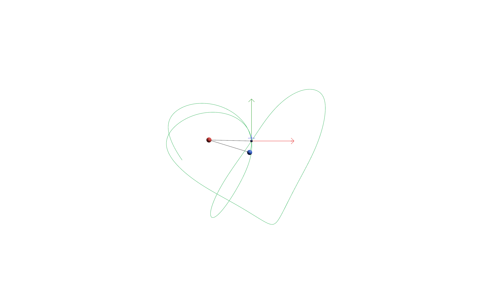

# 3D-Two-Pendulum-Sim

A 3D two-pendulum system solved using Lagrangian mechanics. In the recorded solution, I am outlining a heart with a set of unique initial conditions that give a heart outline.

## The math

The system is two point masses, B and C, connected by rigid massless rods: a pivot A (fixed at the origin) to B (length `L1`), and B to C (length `L2`). Instead of the usual angle-based double-pendulum formulation, the state is tracked directly in Cartesian coordinates with the rod lengths enforced as constraints:

- **State** (`PendulumState` in `src/physics.rs`): position and velocity of B and C, `(r_b, v_b, r_c, v_c)` — 12 numbers total, all measured from the fixed pivot.
- **Constraints**: `|r_b| = L1` and `|r_c - r_b| = L2`, i.e. both rods stay rigid.

Rigid rods are enforced as constraint forces along each rod, scaled by Lagrange multipliers `lam1` and `lam2`. Differentiating both constraints twice (position → velocity → acceleration) turns them into a small linear system:

```
M * [lam1, lam2]^T = b
```

where `M` is a 2×2 matrix built from the current rod geometry and `b` comes from the current velocities and gravity. Solving that system at every evaluation gives the instantaneous constraint forces, and from there the accelerations:

```
a_b = gravity + (r_b * lam1 - d * lam2) / M1
a_c = gravity + (d * lam2) / M2       where d = r_c - r_b
```

This is solved fresh on every derivative evaluation — the multipliers are never integrated directly, only recomputed from the current state (see `accel()` in `src/physics.rs`).

**Drift correction**: because of accumulated floating-point error, the RK4 state alone will slowly stretch the rods and pick up small velocity components along their length. After every step, `apply_drift_correction` renormalizes both rods back to their nominal lengths and projects out the velocity component along each rod, so the constraints stay (numerically) exactly satisfied.

**Energy diagnostic**: total mechanical energy (`energy()` = kinetic + potential) is logged once a second as a sanity check — in a correct integrator this should stay roughly flat; steady drift would mean the integrator/correction step is adding real error on top of the system's inherent chaos.

## Why the trail draws a heart

The double pendulum is chaotic for almost any initial condition, but the specific starting angles used here, `theta1 = 2.4912903` and `theta2 = -2.743706` (measured from straight-down, hardcoded as `THETA1`/`THETA2` in both `src/main.rs` and `src/bin/record.rs`), were taken from a YouTube video that found this pair traces a heart shape. That's the whole explanation — they weren't derived or searched for in this repo.



## Binaries

- **`pendulum3d`** (`src/main.rs`) — interactive 3D viewer. Orbit the camera with the mouse (via `bevy_panorbit_camera`), watch the pendulum swing from the fixed initial angles, and see the swept trail and energy-drift log in the console.

  ```
  cargo run --release --bin pendulum3d
  ```

- **`record`** (`src/bin/record.rs`) — exports the same simulation to video instead of just displaying it. Physics is integrated at a fixed 240Hz (matching the interactive viewer) independent of video frame rate, so the output is deterministic regardless of how fast this machine can render and screenshot each frame. It captures one PNG per video frame (default 60fps) to `media/frames/`, then stitches them into `media/pendulum.mp4` with `ffmpeg` (must be on `PATH`).

  ```
  cargo run --release --bin record [seconds]   # default 45s
  ```

  `media/frames/` and `media/*.mp4` are gitignored — they're regenerated output, not source.

## Recording

🔗 [Google Drive link to a rendered recording](https://drive.google.com/file/d/1UsX_TiwrU99msLE9LTRpoJHin-S8GDH2/view?usp=share_link)
